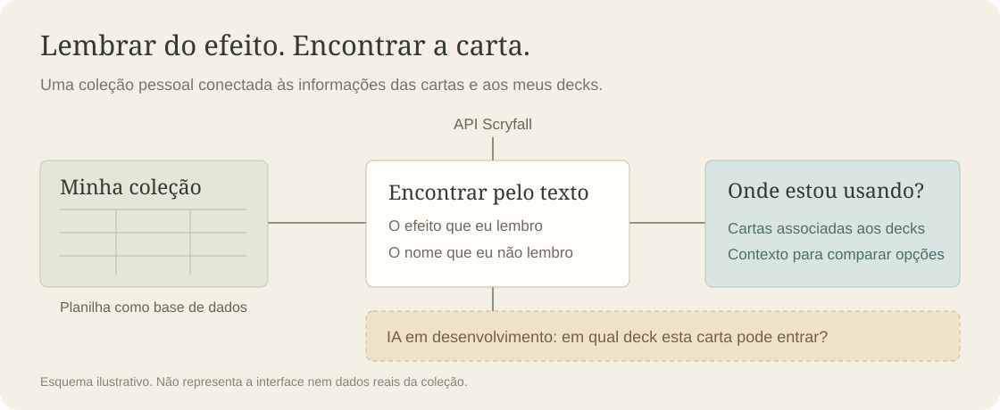

# Magic Collection Manager

**In development** 
Earliest available record: October 29, 2026 · Last application update: unconfirmed 
Presentation updated on November 17, 2026.

My Magic collection created a practical problem: I could remember what a card did without remembering its name. I also needed to know which decks used each card and which cards I already owned might fit another deck.

I started by organizing the collection in a spreadsheet. From there, I developed an organizer connected to the Scryfall API, combining my personal inventory with searchable card information.

[Português](README.md) · [Portfolio](https://github.com/EagleKhan0505)

*Illustrative project diagram. It is not an application screenshot or a copy of my actual inventory.*

## Starting with the cards I own

| When I want to… | The organizer brings together… |
| --- | --- |
| Find a card without remembering its name | Card-text search alongside name search. |
| Look up a card's information | Scryfall integration connected to the collection database. |
| See where a card is used | Associations between cards and their decks. |
| Consider changes to a deck | Collection and deck context for an AI decision-support layer. |

An illustrative search would look for an effect such as **“whenever a creature dies”**. The next step is understanding which decks already use those cards and where another combination might be useful. This example describes the need behind the project; it is not a captured search result.

## From organization to a decision

I also want to answer: **which of my decks would be a good fit for this card?** That is the purpose of the AI decision-support layer I am developing. It builds on collection and deck context, while the final choice remains mine.

My main contribution was turning a personal need into queryable information: the collection, card information and relationships with decks. An external data source reduces manual entry and provides a foundation for exploring recommendations.

**Stage:** in development. The project combines a collection spreadsheet, Scryfall integration, card-text search and deck relationships. The AI decision-support layer is still in development. A public interface demonstration is not yet available.

The full application and collection inventory are private.
