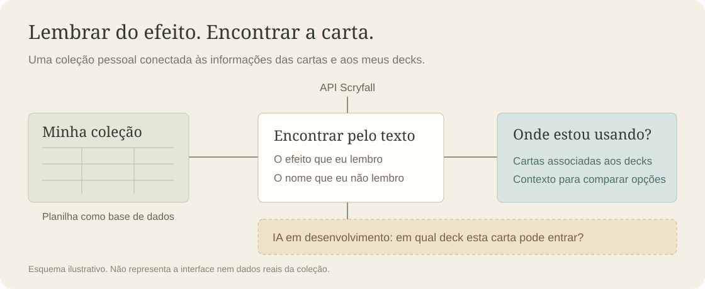

# Organizador Magic

Minha coleção de Magic trouxe um problema bem concreto: eu podia lembrar do que uma carta fazia e, ainda assim, não lembrar do nome dela. Também precisava saber onde estava usando cada carta e quais opções da minha própria coleção poderiam ajudar em outro deck.

Comecei pela organização da coleção em uma planilha. A partir dela, desenvolvi um organizador conectado à API do Scryfall, combinando o registro pessoal das cartas com informações que ajudam a encontrá-las pelo conteúdo.

[English](README.en.md) · [Portfólio](https://github.com/EagleKhan0505)

*Esquema ilustrativo a partir das funções descritas. Não é uma tela da aplicação nem uma reprodução da minha coleção.*

## A coleção como ponto de partida

| Quando quero… | O organizador reúne… |
| --- | --- |
| Encontrar uma carta sem lembrar o nome | Busca pelo texto da carta, além da busca por nome. |
| Consultar as informações de uma carta | Integração com o Scryfall, ligada à base da coleção. |
| Saber onde estou usando uma carta | Associação entre a carta e os decks em que ela está. |
| Pensar em mudanças nos decks | A coleção e seus vínculos como contexto para uma camada de apoio por IA. |

Uma busca ilustrativa seria procurar uma expressão como **“sempre que uma criatura morrer”** para recuperar cartas pelo efeito que me interessa. A etapa seguinte é entender em quais decks essas cartas já aparecem e considerar onde outra combinação pode fazer sentido. O exemplo mostra o tipo de necessidade que motivou o projeto; não representa um resultado de busca capturado nesta página.

## Da organização à decisão

Quero que a base também ajude a responder: **em qual dos meus decks esta carta seria uma boa opção?** Essa é a função da camada de decisão por IA que estou desenvolvendo. Ela parte da coleção e do contexto dos decks, enquanto a escolha final continua comigo.

A parte central da minha contribuição foi estruturar uma necessidade do meu uso pessoal em dados consultáveis: coleção, informações das cartas e relações com decks. A integração com uma fonte externa evita que todo esse conteúdo precise ser preenchido manualmente e cria uma base para explorar recomendações.

**Estágio:** projeto pessoal em evolução. A apresentação descreve a planilha, a integração com o Scryfall, a busca por texto e o acompanhamento dos decks relatados no uso pessoal. A camada de IA permanece em desenvolvimento. Como a versão atual está em outro ambiente, esta página ainda não inclui captura verificável da interface nem demonstração executável.

O código e o inventário completo da coleção não fazem parte deste repositório público.
