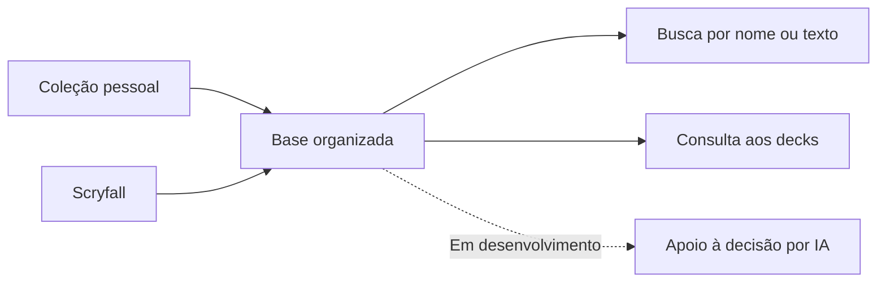

# Organizador Magic

**Minha coleção de cartas como uma base de dados útil para pesquisar, organizar e montar decks.**

[English](README.en.md) · [Gustavo Amaral](https://github.com/EagleKhan0505)

## O problema que resolvi

Eu queria consultar minha coleção de Magic: The Gathering de acordo com o que as cartas fazem, além de procurá-las pelo nome. Também precisava saber onde cada carta estava sendo utilizada e aproveitar melhor o que já possuía ao pensar em outros decks.

Estruturei uma planilha como base de dados e a conectei à API do Scryfall. Essa organização aproxima o acervo pessoal das informações das cartas e da consulta aos decks.

## Funcionalidades do meu fluxo

- Organização da coleção pessoal em uma base estruturada.
- Integração com a API do Scryfall para consultar informações das cartas.
- Pesquisa pelo texto das cartas, além do nome.
- Consulta aos decks em que uma carta já está sendo utilizada.
- Evolução de uma camada de decisão por IA para apoiar a avaliação de cartas que poderiam entrar em outros decks.

## Minha contribuição

Defini a necessidade a partir da minha própria coleção, organizei a base de dados e desenvolvi a integração e o fluxo de consulta com apoio de IA. O projeto combina um interesse pessoal com estruturação de dados, uso de APIs e decisões orientadas por informação.

## Estado atual

Projeto de uso pessoal em evolução. A base, a integração, a busca e a consulta aos decks fazem parte do fluxo descrito; a camada de recomendações por IA permanece em desenvolvimento.

**Recursos:** planilha como base de dados, API do Scryfall, pesquisa textual e organização de decks.

Esta apresentação descreve o projeto sem distribuir a implementação nem os dados da coleção. Magic: The Gathering e Scryfall são referências de terceiros; este é um projeto pessoal independente.
